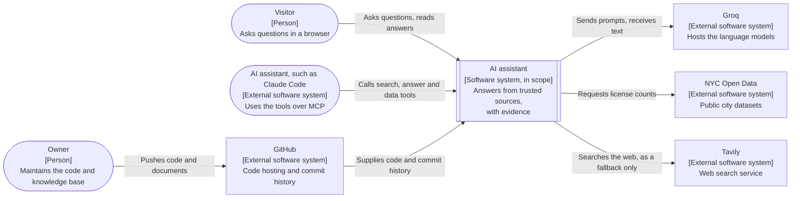
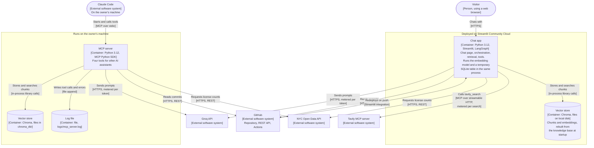
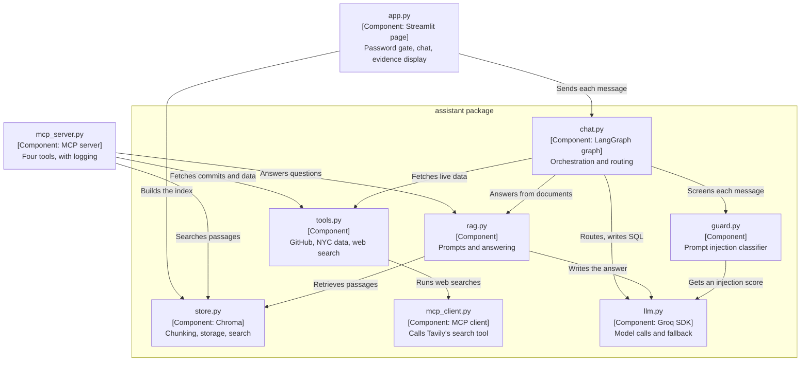
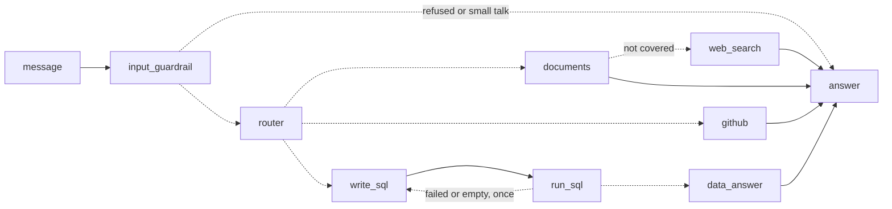

# The assistant at three levels of design

The same system described three times, each time closer to the code.
Each level answers a different question for a different reader. Read
from the top and stop at the level you need.

| Level | Question it answers | Typical reader | Unit of design |
|---|---|---|---|
| [1. Solution architecture](#1-solution-architecture) | What problem does it solve, for whom, and with which outside services? | Business owner, architect, hiring manager | The whole system as one box |
| [2. System design](#2-system-design) | Which running parts is it made of, where do they run, and how do they talk? | Architect, engineer | Processes, data stores, protocols |
| [3. Detailed design](#3-detailed-design) | How is each part built inside? | Engineer working on the code | Modules, functions, data structures |

The diagrams follow the [C4 model](https://c4model.com), a widely
used way of drawing software architecture at increasing levels of
detail:

| Level here | C4 diagram | Also known as |
|---|---|---|
| 1. Solution architecture | System context diagram | Context view |
| 2. System design | Container diagram | High-level design (HLD) |
| 3. Detailed design | Component diagram, plus a dynamic diagram | Low-level design (LLD) |

Following C4's notation guidance, every diagram has a title, a key,
an element type on every box, the technology of every container, and
a label on every arrow. The diagrams are written in Mermaid, which
GitHub draws from the text. The "decisions" tables are a short form of
architecture decision records (ADRs): each states the decision, the
alternative rejected and the reason.

For the full specification, see [ARCHITECTURE.md](../ARCHITECTURE.md).

## 1. Solution architecture

**The problem.** Knowledge lives in documents, but also in databases
and live systems, and no single technique fits all of them. The
assistant answers questions from sources it can trust, picks the right
technique for each kind of source, and shows the evidence for every
answer.

**System context diagram: the AI assistant**

*Key: rounded box, a person or an outside party that starts an
interaction; double border, the system being described; plain box, an
external system. Every arrow points from the one acting to the one
acted on.*

**Business capabilities**

| Capability | Source | Technique |
|---|---|---|
| Answer questions about the project and its creator | Knowledge base of 10 documents | RAG (retrieval-augmented generation) |
| Report what changed recently | GitHub commit history | Live API call |
| Answer questions that need a count or total | NYC Open Data | Text-to-SQL on a read-only table |
| Answer general questions the documents do not cover | The web | Web search, clearly labelled as unverified |
| Let other AI assistants use these capabilities | The four tools above | MCP server |

**Quality attributes** (also called non-functional requirements)

| Attribute | Requirement | How it is met |
|---|---|---|
| Groundedness | Every answer is grounded in a source and shows it | Answers only from retrieved or fetched content; abstains otherwise |
| Security | The model cannot be talked into acting | Guardrails enforced in code; the model only produces text |
| Privacy | No personal data is looked up or downloaded | Counts only from NYC data; web search blocked for people and contact details |
| Availability | Best effort, for a demo | Fallback model; failures explained on the page, not hidden |

**Constraint: cost.** Everything runs on free tiers, so the design uses
a small model by default, limits each visit to 20 questions and caches
tool results. In a paid deployment the running cost would come from
two metered services, language-model tokens (Groq) and web searches
(Tavily), plus hosting. Levels 2 and 3 show where each is spent.

**Decisions made at this level**

| Decision | Alternative rejected | Why |
|---|---|---|
| Build the RAG pipeline | Buy a ready-made RAG platform | The demo exists to show the mechanics |
| Hosted models through an API (Groq) | Run models on own hardware | No hardware, free tier, fast responses |
| Free hosting (Streamlit Community Cloud) | A paid cloud platform | Cost, and enough for a demo |
| Public repository | Private | The code is part of what is being shown |

## 2. System design

**The running parts.** The chat page and the assistant run as one
Python process on Streamlit Community Cloud. The vector store and the
embedding model run inside that process. The MCP server is a separate
process, started on demand by its client on the user's own machine.

**Container diagram: the AI assistant**

*Key: rounded box, a person or outside party; plain box, a container
(something that must be running) or an external system; cylinder, a
data store; labelled outer box, where the containers are deployed. Labels
in square brackets give the element's type and technology, or an
arrow's protocol. "Metered" marks a connection billed per use.*

The embedding model (all-MiniLM-L6-v2) and the temporary SQLite table
are libraries inside the chat app's process, so in C4 terms they are
parts of that container, not containers of their own. The deployment
boundaries are drawn on this diagram for brevity; a larger system
would show them in a separate C4 deployment diagram.

**Data stores**

| Store | Holds | Lifetime | Source of truth |
|---|---|---|---|
| `data/` folder | The knowledge base: 10 Markdown documents | Permanent, in git | Yes |
| Chroma | Chunks and their embeddings | Rebuilt at startup and when a document changes | No, derived from `data/` |
| SQLite | Monthly license counts for one query | One query | No, fetched from NYC Open Data |
| In-process caches | GitHub results (10 minutes), NYC data (6 hours) | Until expiry or restart | No |

Nothing a visitor types is stored permanently. Version 2 adds a system
of record; see [design_v2.md](design_v2.md).

**Protocols**

| Connection | Protocol |
|---|---|
| Browser to app | HTTPS, managed by Streamlit |
| Claude Code to MCP server | MCP over stdio (standard input and output) |
| App to Tavily | MCP over streamable HTTP, key in a header |
| App to Groq, GitHub, NYC Open Data | HTTPS REST |

**Cost view**

Where money would be spent in a paid deployment. Prices are left out
because they change; the cost of each line is its volume times the
provider's current price.

| Cost item | Where | Driver | Today |
|---|---|---|---|
| Language-model tokens | Chat app and MCP server, to Groq | Model calls per message, and tokens per call | Free tier: 8,000 tokens a minute and 200,000 a day per model |
| Classifier calls | Chat app, to Groq | One per message that reaches the input guardrail | Free tier, with its own allowance |
| Web searches | Chat app, to Tavily | One credit per web answer | Free tier |
| Hosting | Streamlit Community Cloud | Uptime and memory | Free |
| Embeddings | Inside the chat app | Computed locally at indexing and per question | No per-call fee; uses the app's own compute |
| GitHub and NYC Open Data | Chat app and MCP server | Requests | Free public APIs; results cached to stay within rate limits |

Tokens are the main variable cost; level 3 breaks them down per
message.

**Cross-cutting concerns**

| Concern | Design |
|---|---|
| Resilience | A fallback model takes over when the default is rate-limited, and the limited model is skipped for 10 minutes; a failed web search keeps the documents' abstention |
| Security | Secrets in environment variables; password gate; input guardrail; read-only SQL |
| Cache invalidation | The index is keyed by a hash of the documents, so a changed document triggers re-indexing |
| Observability | Logs to the host's console and, for the MCP server, to a log file |
| Delivery | Every push runs the tests in GitHub Actions and redeploys the app |

**Decisions made at this level**

| Decision | Alternative rejected | Why |
|---|---|---|
| Embedded vector store (Chroma in-process) | A separate vector database server | Small corpus; nothing extra to run |
| Rebuild the index at startup | A persistent hosted index | The host's storage is temporary, and the index is derived from `data/` anyway |
| One shared core, two front ends | Separate code for the chat page and the MCP server | Both give the same answers from the same code |
| Text-to-SQL on a temporary SQLite table | Indexing the data as text for retrieval | Retrieval cannot total a column or count rows; SQL can, and can be checked in code |

## 3. Detailed design

**Modules.** Two entry points sit at the top of the repository. Both
import the `assistant` package, and nothing in the package imports
them back.

**Component diagram: the chat app and the MCP server**

*Key: each box is a Python module, shown as a component. Arrows mean
"calls", labelled with the purpose of the call. Nothing in the
`assistant` package calls the two files above it.*

**Dynamic diagram: one message through the orchestration graph**

This is the graph in `chat.py`, built with LangGraph. Each box is a
node; each arrow is an edge.

*Key: solid arrow, an edge that always runs; dashed arrow, a
conditional edge, taken only when its condition holds. "message" and
"answer" are the start and end of the graph.*

**Model calls and tokens per message**, by the path a message takes
through the graph. Token figures are estimates from development, not
measurements of live traffic.

| Path | Classifier calls | Language-model calls | Tokens, roughly | Other metered use |
|---|---|---|---|---|
| Small talk | 0 | 0 | 0 | None |
| Refused for length | 0 | 0 | 0 | None |
| Refused by the input guardrail | 1 | 0 | Classifier only | None |
| Documents | 1 | 2: route, answer | 2,000 to 3,000 | None |
| GitHub | 1 | 2: route, answer | Somewhat fewer than documents | None |
| NYC data | 1 | 3: route, write SQL, answer; 4 if the SQL is retried | Not measured separately; most messages use 2,500 to 4,000 | None |
| Web fallback | 1 | 3: route, documents attempt, answer | About 1,000 more than documents | 1 Tavily search credit |

Most of a documents answer's tokens are the five retrieved passages.
The model evaluation measured about 14,000 tokens for its 11 cases on
each model.

**Design choices that keep token spend down**

| Choice | Effect |
|---|---|
| Small talk answered in code | No model call for "thanks" or "hi" |
| Routing and query rewriting in one call | One call where two would be usual |
| 5 passages of about 500 characters each | Bounds the largest part of every prompt |
| History cut to 4 messages of 400 characters | Bounds the conversation's share of every prompt |
| Web results cut to 3, each 500 characters | Bounds the most expensive path |
| Smaller model by default | Several times cheaper per token on a paid plan |
| Cached GitHub and NYC results | Fewer outside requests; no effect on tokens |
| 20 questions per visit | Caps the spend of any one visitor |

**Main interfaces**

| Function | Module | Takes | Returns |
|---|---|---|---|
| `respond` | `chat` | A question, the collection, recent history | A result: answer, status, tool, sources, evidence |
| `route` | `chat` | A question and history | The tool to use and the question rewritten as a standalone question |
| `answer` | `rag` | A question and the collection | The answer, its sources and the retrieved passages |
| `search` | `store` | The collection, a query, how many results | Passages with their source and distance |
| `ask` | `llm` | A prompt, instructions, a model | The model's reply, with fallback on a rate limit |
| `looks_like_injection` | `guard` | A message | True if the classifier's score is 0.5 or above |
| `query_license_data` | `tools` | A SQL statement | Columns and rows, after the statement passes the checks |
| `call_tavily` | `mcp_client` | A query and a key | The search tool's result |

Every result carries a **status**: `answered`, `not_covered`,
`unclear`, `blocked` or `small_talk`. The page decides what to show
from the status, not from the wording of the answer.

**Key mechanisms**

| Mechanism | Design |
|---|---|
| Chunking | About 500 characters; a new chunk at each heading, and a heading is never separated from the paragraph after it |
| Retrieval | Top 5 chunks by squared L2 distance between 384-dimension embeddings |
| Abstention | The model returns a sentinel value (a fixed, reserved word) when the source lacks the answer, and code writes the refusal |
| Conversation memory | The last 4 messages, each cut to 400 characters; a follow-up is rewritten as a standalone question before retrieval |
| Instruction and data separation | Instructions in the system role; the visitor's words and all fetched text in the user role |
| Determinism | Temperature 0 on every model call |
| Testing | 333 automated tests with fakes in place of the model and the APIs, plus a retrieval benchmark of 125 questions |

Exact values for every parameter are in the
[parameter reference](../ARCHITECTURE.md#18-parameter-reference).
