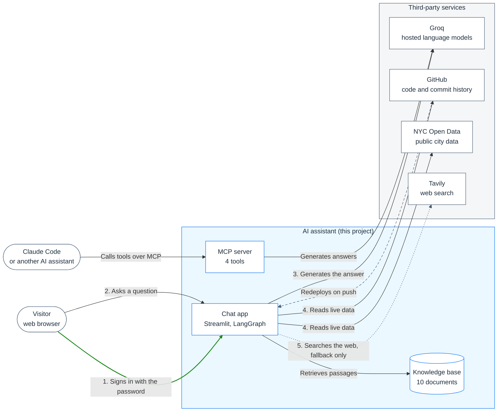
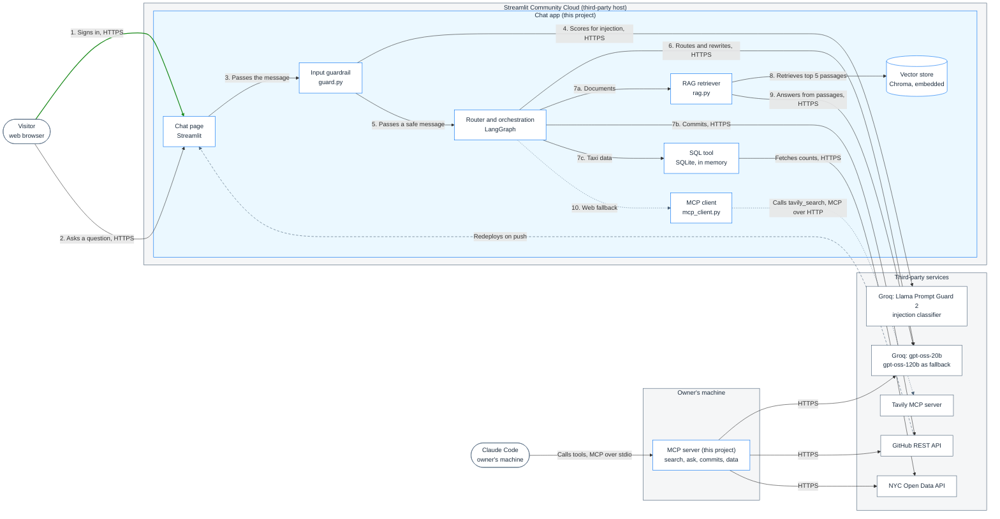
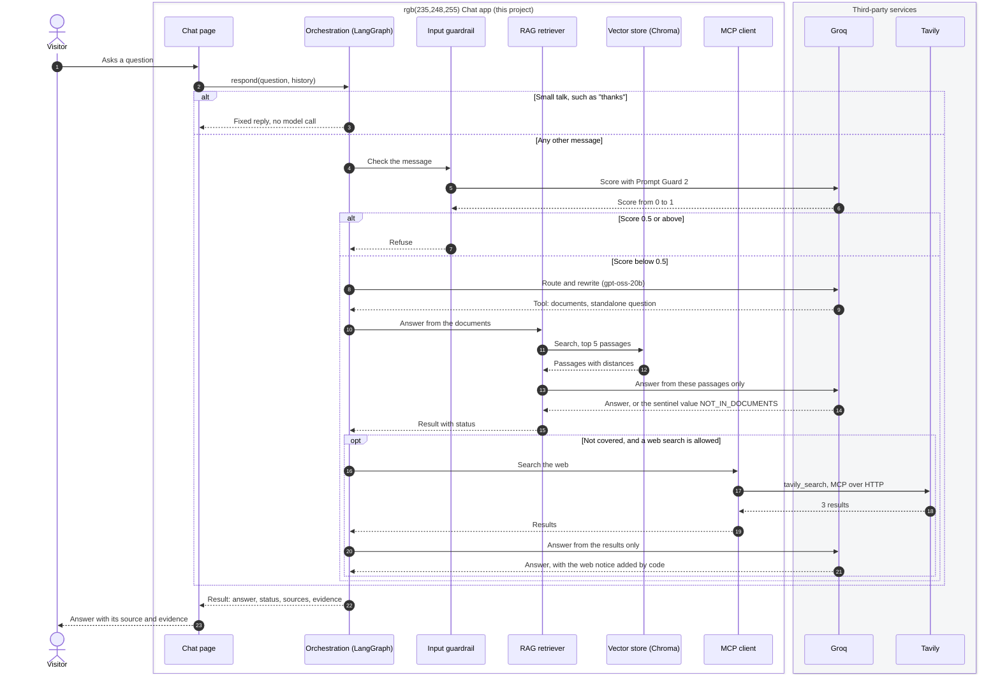

# The assistant in SAP diagram conventions

The assistant described at three levels of design, from the overall
solution down to the order of calls inside it, drawn the way SAP draws
solution diagrams. Read from the top and stop at the level you need.
For the full specification, see [ARCHITECTURE.md](../ARCHITECTURE.md).

## Which SAP conventions, and how they map

SAP publishes two sources of guidance for solution diagrams:

- the **[SAP BTP Solution Diagram Guidelines](https://sap.github.io/btp-solution-diagrams/)**,
  which set the colours, areas, line styles and numbering
- the **[SAP Architecture Center](https://architecture.learning.sap.com/docs/community/diagrams)**,
  which defines two levels of diagram and recommends Mermaid for
  lightweight flows and sequence diagrams for component interactions

| Level here | SAP diagram | SAP's definition |
|---|---|---|
| 1. Solution architecture | **L1 solution diagram** | "A high-level overview of solution architectures, focusing on key components and their relationships" |
| 2. System design | **L2 solution diagram** | "Detailed technical representations, including service interactions, data flows, and integration points" |
| 3. Detailed design | **Sequence diagram** | Recommended by the Architecture Center for component interactions |

**Conventions applied**

| Convention | SAP rule | Here |
|---|---|---|
| Areas | Blue for SAP-owned areas (`#0070F2` border, `#EBF8FF` fill); grey for non-SAP (`#475E75`, `#F5F6F7`) | Blue for the solution this project owns; grey for third parties. See the adaptation note below. |
| Nesting | Alternate filled and unfilled areas so nested areas contrast | The blue solution area sits inside the grey hosting area |
| Solid line | Direct, synchronous request and response | Every API call and page request |
| Dashed line | Indirect, asynchronous flow | The redeploy triggered by a push to GitHub |
| Dotted line | Optional flow | The web search, which runs only as a fallback |
| Authentication flow | Usually green | The visitor's password sign-in |
| Numbers | Mark a specific path through the diagram | The path of one question, in order |
| Legend | Every diagram includes one | Under each diagram |
| Text | Titles `#1D2D3E`, body `#556B82` | Applied to every box |

**Adaptations, stated openly**

- **Blue means "ours", not "SAP's".** This project contains no SAP
  products. In SAP's diagrams the blue area is SAP's platform; here it
  stands for the solution being described, and everything provided by
  someone else is grey.
- **No official icons.** SAP's diagrams use official service icons in
  draw.io. Mermaid cannot use them, so each box names its technology
  in text. The Architecture Center accepts Mermaid for lightweight,
  non-product-specific flows.
- **SAP's internal notation is not used.** For internal technical
  architecture SAP has historically used TAM (Technical Architecture
  Modeling), built from FMC block diagrams and parts of UML. Its rules
  are not fully public, so it is not imitated here.

## 1. L1 solution diagram

**L1: AI assistant, solution overview**

*Legend: blue area, the solution this project owns; grey area, third-party
services. Green line, authentication. Solid line, synchronous request and
response. Dotted line, optional flow. Dashed line, asynchronous flow.
Numbers, the path of one question, in order; the two steps numbered 4
are alternatives, chosen by the question.*

**Constraint: cost.** Everything runs on free tiers, so the design uses
a small model by default, limits each visit to 20 questions and caches
tool results. In a paid deployment the running cost would come from
two metered services, language-model tokens (Groq) and web searches
(Tavily), plus hosting. The L2 and sequence sections below show
where each is spent.

**Decisions made at this level**

| Decision | Alternative rejected | Why |
|---|---|---|
| Build the RAG pipeline | Buy a ready-made RAG platform | The demo exists to show the mechanics |
| Hosted models through an API (Groq) | Run models on own hardware | No hardware, free tier, fast responses |
| Free hosting (Streamlit Community Cloud) | A paid cloud platform | Cost, and enough for a demo |
| Public repository | Private | The code is part of what is being shown |

## 2. L2 solution diagram

**L2: AI assistant, services, data flows and integration points**

*Legend: blue area, components this project owns; grey area, third
parties, including the host the app runs on. Green line,
authentication. Solid line, synchronous request and response. Dotted
line, optional flow. Dashed line, asynchronous flow. Numbers, the path
of one question; 7a, 7b and 7c are alternatives chosen by the router,
and step 10 runs only when the documents do not cover a general
question.*

**Cost view**

Where money would be spent in a paid deployment. Prices are left out
because they change; the cost of each line is its volume times the
provider's current price.

| Cost item | Where | Driver | Today |
|---|---|---|---|
| Language-model tokens | Chat app and MCP server, to Groq | Model calls per message, and tokens per call | Free tier: 8,000 tokens a minute and 200,000 a day per model |
| Classifier calls | Chat app, to Groq | One per message that reaches the input guardrail | Free tier, with its own allowance |
| Web searches | Chat app, to Tavily | One credit per web answer | Free tier |
| Hosting | Streamlit Community Cloud | Uptime and memory | Free |
| Embeddings | Inside the chat app | Computed locally at indexing and per question | No per-call fee; uses the app's own compute |
| GitHub and NYC Open Data | Chat app and MCP server | Requests | Free public APIs; results cached to stay within rate limits |

Tokens are the main variable cost; the sequence section below breaks
them down per message.

**Decisions made at this level**

| Decision | Alternative rejected | Why |
|---|---|---|
| Embedded vector store (Chroma in-process) | A separate vector database server | Small corpus; nothing extra to run |
| Rebuild the index at startup | A persistent hosted index | The host's storage is temporary, and the index is derived from `data/` anyway |
| One shared core, two front ends | Separate code for the chat page and the MCP server | Both give the same answers from the same code |
| Text-to-SQL on a temporary SQLite table | Indexing the data as text for retrieval | Retrieval cannot total a column or count rows; SQL can, and can be checked in code |

## 3. Sequence diagram

**One question answered from the documents, with the web fallback**

*Legend: blue box, components this project owns; grey box, third-party
services. Solid arrow, a request; dashed arrow, its response. "alt"
marks alternatives, one of which happens; "opt" marks an optional
step. Numbers give the order of messages.*

**Model calls and tokens per message**, by the path a message takes
through the graph. Token figures are estimates from development, not
measurements of live traffic.

| Path | Classifier calls | Language-model calls | Tokens, roughly | Other metered use |
|---|---|---|---|---|
| Small talk | 0 | 0 | 0 | None |
| Refused for length | 0 | 0 | 0 | None |
| Refused by the input guardrail | 1 | 0 | Classifier only | None |
| Documents | 1 | 2: route, answer | 2,000 to 3,000 | None |
| GitHub | 1 | 2: route, answer | Somewhat fewer than documents | None |
| NYC data | 1 | 3: route, write SQL, answer; 4 if the SQL is retried | Not measured separately; most messages use 2,500 to 4,000 | None |
| Web fallback | 1 | 3: route, documents attempt, answer | About 1,000 more than documents | 1 Tavily search credit |

Most of a documents answer's tokens are the five retrieved passages.
The model evaluation measured about 14,000 tokens for its 11 cases on
each model.

**Design choices that keep token spend down**

| Choice | Effect |
|---|---|
| Small talk answered in code | No model call for "thanks" or "hi" |
| Routing and query rewriting in one call | One call where two would be usual |
| 5 passages of about 500 characters each | Bounds the largest part of every prompt |
| History cut to 4 messages of 400 characters | Bounds the conversation's share of every prompt |
| Web results cut to 3, each 500 characters | Bounds the most expensive path |
| Smaller model by default | Several times cheaper per token on a paid plan |
| Cached GitHub and NYC results | Fewer outside requests; no effect on tokens |
| 20 questions per visit | Caps the spend of any one visitor |

**Main interfaces**

| Function | Module | Takes | Returns |
|---|---|---|---|
| `respond` | `chat` | A question, the collection, recent history | A result: answer, status, tool, sources, evidence |
| `route` | `chat` | A question and history | The tool to use and the question rewritten as a standalone question |
| `answer` | `rag` | A question and the collection | The answer, its sources and the retrieved passages |
| `search` | `store` | The collection, a query, how many results | Passages with their source and distance |
| `ask` | `llm` | A prompt, instructions, a model | The model's reply, with fallback on a rate limit |
| `looks_like_injection` | `guard` | A message | True if the classifier's score is 0.5 or above |
| `query_license_data` | `tools` | A SQL statement | Columns and rows, after the statement passes the checks |
| `call_tavily` | `mcp_client` | A query and a key | The search tool's result |

Every result carries a **status**: `answered`, `not_covered`,
`unclear`, `blocked` or `small_talk`. The page decides what to show
from the status, not from the wording of the answer.

Sources: [SAP BTP Solution Diagram Guidelines: foundation](https://sap.github.io/btp-solution-diagrams/docs/btp_guideline/foundation/),
[areas](https://sap.github.io/btp-solution-diagrams/docs/btp_guideline/diagr_comp/areas/),
[connectors](https://sap.github.io/btp-solution-diagrams/docs/btp_guideline/diagr_comp/lines_connectors/),
[numbers](https://sap.github.io/btp-solution-diagrams/docs/btp_guideline/diagr_comp/numbers/);
[SAP Architecture Center: diagrams](https://architecture.learning.sap.com/docs/community/diagrams).
