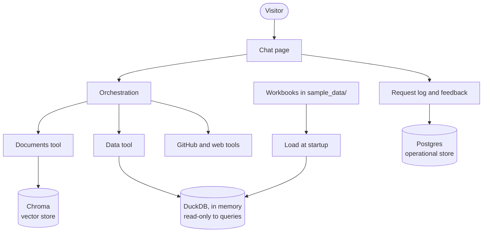
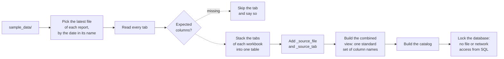
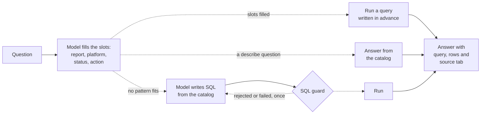

# Version 2 design: workbook data, and a system of record

| | |
|---|---|
| **Status** | Current, except phase 3, which [ADR-0015](../adr/0015-hybrid-workflow-and-agent.md) changes. A revised design will supersede this one and be added to this folder. Phase 1 is done; phase 2 is under way. |
| **Date** | 11 October 2026; phase 3 revised 20 October 2026 |
| **Author** | Jack Mei, with Claude Code |
| **Scope** | Design, decisions, risks, build order and estimate for the second version of the assistant |

For how the current system works, see
[ARCHITECTURE.md](../../ARCHITECTURE.md). The decisions behind
this design are recorded in [docs/adr/](../adr/).

## 1. Summary

Version 1 answers from sources the project owns: its knowledge base,
GitHub and one public dataset. Version 2 adds two things.

1. **Workbook data.** The assistant answers questions from a fixed
   folder of multi-tab Excel workbooks: the latest marketing reports,
   one workbook per channel group. It loads every tab into an
   analytical database. The common questions, such as "how many live
   creatives on Reddit?", go to a structured tool that runs tested
   queries; anything else goes to text-to-SQL. Each answer shows the
   query, the rows and the source file and tab behind it. Letting
   visitors upload their own files follows as an optional later phase.
2. **A system of record.** The assistant keeps a permanent log of
   requests and of visitors' feedback on answers, in a transactional
   database.

Together these give the project the storage pattern most enterprises
use: an analytical store and an operational store, each doing the job
it was built for, alongside the existing vector store.

Starting from a fixed, trusted folder and not from uploads follows
the pattern of an internal reporting assistant: the data arrives as
the latest reports in a known place, and nobody uploads anything. It
removes most of the risk and work that uploads bring, while keeping
what makes the data hard: many tabs, several files, and inconsistent
columns.

Before either feature, the code is reorganised so that adding a tool
is one file, plus its documentation, and not eight edits.

**Estimate:** 17 to 24 hours of working time, in five or six
sessions. Section 12 gives the basis.

## 2. Goals and non-goals

**Goals**

- A visitor can ask about the workbook data in plain language and get
  correct numbers, each answer showing its SQL, its rows and the
  source file and tab.
- Questions can span tabs and workbooks, such as live creatives across
  every channel.
- The most recent workbook of each report is used, chosen by the date
  in its file name.
- Every request and every piece of feedback is recorded durably, in a
  form that can be audited.
- Adding a tool requires one new file, plus its documentation.
- Every safety property of version 1 still holds, and the new attack
  surface has tests.

**Non-goals**

- User accounts or sign-in.
- Keeping uploaded files between visits.
- Large files. This is a proof of value, not a data platform.
- Joining workbook data to the knowledge base or the NYC dataset.
- Using feedback to change the assistant automatically.

## 3. Where version 1 stands

Eight modules in a flat layout, about 2,600 lines of code and 2,200
of tests. 317 tests run on every push. One vector store (Chroma), one
temporary SQLite table for the public dataset, and no permanent
storage of any kind: nothing survives a restart.

Two limits of that design motivate this one:

- **Adding a tool touches eight places:** the fetch function, the
  description the model reads, a graph node, a graph edge, the
  evidence display, the source label, the MCP server and the
  knowledge base.
- **Nothing is remembered.** There is no record of what was asked,
  how often, or whether the answers were any good.

## 4. Proposed architecture

### 4.1 Three stores, three jobs



| Store | Holds | Lifetime | Workload | Why this one |
|---|---|---|---|---|
| **Chroma** | The knowledge base index | Rebuilt on demand | Search by meaning | Unchanged from version 1 |
| **DuckDB, in memory** | The workbook data, and the public dataset | Rebuilt at startup and when a workbook changes | Analytical: scans and aggregates | Built for analytics; runs inside the app; nothing written to disk |
| **Postgres** | The request log and feedback | Permanent, append-only | Transactional: many small writes | Durable, concurrent, auditable |

This is the operational and analytical split at small scale. The
application writes to the operational store. Analysis happens in the
analytical engine. Neither is asked to do the other's job.

### 4.2 Why feedback does not live in DuckDB

It was considered. Three reasons against:

- **Durability.** Workbook tables are rebuilt from files; feedback
  is original data that cannot be rebuilt. The host wipes local files on
  restart.
- **Workload.** DuckDB allows one writing process and is not designed
  for many small concurrent writes.
- **Security.** The model writes the SQL that runs on DuckDB. Keeping
  feedback elsewhere preserves a guarantee that can be stated in one
  line: the model can never write, and can never read the record of
  what visitors did.

### 4.3 How the workbooks are loaded and queried



At question time there are two paths, tried in order:



1. **The structured tool (phase 3a).** For the common pattern, "how
   many live or not live creatives on a platform", the model only
   fills in slots: `report`, `platform`, `status` and `action` (count,
   show or describe). The code runs a query written and tested in
   advance. The model never writes SQL on this path, so the numbers
   are exact. Describe questions, such as "what columns are in Site
   Serve?", are answered from the catalog with no query at all.
2. **Text-to-SQL (phase 3b).** For questions no pattern fits, the
   model reads the catalog and writes one SQL query against the tables
   or the combined view. The SQL guard and the single retry work as
   they do today.

Both paths cite the source file and tab of the rows they used.

**Why stack the tabs.** Within a workbook every tab has the same
columns: one tab per platform. Stacked into one table, "compare
platforms" becomes a `GROUP BY` instead of a join across seven tables,
and the two lineage columns keep every row traceable.

**Why a combined view.** Each workbook names the same ideas
differently: the creative status is `Creative ID Status`, `Creative
Status` or `Creative UID Status`, depending on the file. The view maps
them to one standard set of names, so a question across all channels
is one query. In analytics terms it is a small semantic layer.

**The catalog** is what the model sees, not the files: for each table
and the view, its columns and types, row count, a few sample values,
and which file and tabs it came from. With three tables and one view
the whole catalog fits in the prompt. If the number of tables grows,
a table-selection step comes first (open decision 2).

### 4.4 Business definitions

The data allows more than one correct-sounding answer to the core
questions, so the meaning of each term is fixed here. This is the
project's semantic layer: one agreed meaning per term.

| Term | Definition | Why it matters |
|---|---|---|
| **Creative** | The unit that is counted. Status belongs to a creative, not to a campaign. | On Reddit, 29 creatives are live, spread across 13 of its 15 campaigns |
| **Live** | Status `Live` | |
| **Not live** | Status `Not Live` only | On Twitter Paid, 24 creatives are not live and 8 have status `Unknown`; folding them together would give 32 |
| **Unknown** | Reported separately, never folded into either count | As above: "24 not live, and 8 with unknown status" |
| **Campaigns** | A question about campaigns is answered with both numbers | "29 live creatives across 13 campaigns" |
| **Platform** | A tab of a workbook | Site Serve has one tab, so there the platform is the report |
| **Report** | A workbook: Paid Social, Site Direct or Site Serve | |
| **Show** | Both counts, plus the matching rows, up to 50 | "Show live and not live on LinkedIn" |

**Platform synonyms.** People name platforms differently from the
tabs, so the tool maps common names before it runs:

| People say | Tab |
|---|---|
| Facebook, Meta, FB | Facebook Paid |
| Twitter, X | Twitter Paid |
| LinkedIn | LinkedIn |
| Reddit, Xing, LINE | The tab of the same name |
| Display | Display (Site Direct) |
| Default, default buy | Default Buy, in the report named; asked when no report is named |
| Site Serve | All Data (Site Serve) |

**Questions the structured tool must answer exactly**, which become
test and evaluation cases:

| Pattern | Examples |
|---|---|
| Count by status and platform | How many live campaigns on Reddit? How many not live on Twitter Paid? How many live on Display for Site Direct? How many live creatives for Site Serve? |
| Show by platform | Show live and not live on Twitter Paid. Show live and not live on LinkedIn. |
| Describe | Tell me about paid social creatives. What columns are in Site Serve? Describe the Reddit sheet. |

### 4.5 The sample workbooks

Three workbooks in `sample_data/`, about 700 rows in total. They are
synthetic: generated data, renamed so that nothing resembles a real
company's reports.

| Workbook | Tabs | Rows | Columns |
|---|---|---|---|
| `paid_social_creatives_2025-10-26.xlsx` | Facebook Paid, Reddit, LinkedIn, Twitter Paid, Xing, LINE, Default Buy | 405 | 35 |
| `site_direct_creatives_2025-10-25.xlsx` | Display, Default Buy | 190 | 24 |
| `site_serve_creatives_2025-10-26.xlsx` | All Data | 100 | 22 |

They keep the problems real reports have, on purpose, because each one
tests the design:

| Problem | Example | Handled by |
|---|---|---|
| IDs restart on every tab | `PL-10000` appears on every Paid Social tab | `_source_tab` |
| The same ID means two things | `CR-LIN-1000` is a LinkedIn creative and also a LINE creative | `_source_tab`, and a test |
| One idea, three column names | Creative status, and "days since end", differ by file | The combined view |
| The report date is only in the file name | `..._2025-10-26.xlsx` | The latest-file rule |
| Some values contradict each other | A few Facebook rows name another platform as sub-vendor | Nothing: generated data; answers report what the data says |

The original generated files are kept locally and are not published.

### 4.6 Layers

Dependencies point downward only.

| Layer | Contents |
|---|---|
| **Interfaces** | Chat page, MCP server |
| **Orchestration** | The LangGraph flow |
| **Capabilities** | Tools, retrieval, input guardrail |
| **Storage and ingestion** | Vector store, analytical store, operational store; loaders for documents and files |
| **Providers** | Language models, outside APIs |

## 5. Decisions made

| Decision | Choice | Why | Alternative set aside |
|---|---|---|---|
| Analytical store | DuckDB, in memory | Built for analytics, no server, open source | SQLite: works, but not an analytical engine |
| Operational store | Managed Postgres | Durable on a host that wipes local files; the standard choice | A local file: lost on restart |
| Where feedback lives | Postgres, not DuckDB | Section 4.2 | One database for everything |
| Data source for phase 3 | A fixed folder of workbooks, loaded at startup | Mirrors an internal reporting assistant; most of the value with little of the risk | Visitor uploads first: the most work and risk |
| Table shape | One table per workbook, its tabs stacked, plus `_source_file` and `_source_tab` | Tabs share columns; lineage keeps rows traceable and IDs distinct | One table per tab: questions across platforms need joins |
| How questions become queries | A structured tool for the common pattern first; text-to-SQL for the rest | The core questions get exact, tested answers; flexibility follows as a separate step | Text-to-SQL only: more ways to be wrong on the questions asked most |
| Counting and status | The definitions in section 4.4 | One agreed meaning per term | Leaving the model to choose |
| Cross-workbook questions | A combined view with standard column names | One query across all channels; a small semantic layer | Leaving the model to reconcile column names |
| Which files | The latest of each report, by the date in the file name | The date is not in the data | File modification time: changes when a file is copied |
| How Excel is read | openpyxl, values only, into DuckDB | Never runs macros or evaluates formulas | DuckDB's Excel extension: fewer controls over what is read |
| Sample data | Synthetic and genericised; originals not published | Nothing resembling a real company's reports is public | Publishing the generated files as they were |
| Lifetime of uploads, when added | The visit only | Privacy, and no storage to manage | Keeping files: needs accounts and a retention policy |
| One SQL engine | Move the public dataset to DuckDB too | One dialect and one set of safety rules to maintain | Keeping SQLite beside DuckDB |
| Storage access | Behind a small interface with swappable backends | Tests need no real database; the provider can change later | Calling Postgres directly throughout |
| Order of work | Restructure first, then features | A no-behaviour change is safest alone | Restructuring while adding features |
| Tool design | One file per tool, read by the graph, the page and the MCP server | Removes the eight-places problem | Folders only, same wiring |
| Tool interface | Our own small interface, with the fields LangChain's `BaseTool` and MCP's tool definitions use: name, description, argument schema | The mechanics stay visible; moving to `BaseTool` later is simple because the fields match | LangChain's `BaseTool`: ties the tools to conventions not adopted elsewhere in the project |
| Evidence | Tools return evidence as data with a kind; the page holds one renderer per kind | Tools contain no interface code, and the MCP server can use the same output | Each tool drawing its own evidence: breaks the layering |

## 6. Decisions still open

Each needs an answer before its phase starts.

| # | Question | Recommendation | Needed by |
|---|---|---|---|
| 1 | Offer the workbook query as a tool on the project's MCP server? | Yes, after it works in the chat page | Phase 3 |
| 2 | For text-to-SQL, send the whole catalog or select tables first? | The whole catalog while there are few tables; add a selection step past about ten | Phase 3b |
| 3 | Upload limits, if uploads are added | `.xlsx` and CSV only; 5 MB per file, 10 MB per visit, 5 files, 50,000 rows per table, 100 columns, about 50 MB expanded; a tab picker; remove and replace | Phase 3c |
| 4 | Observability and the system of record | Three options under review: LangSmith with DuckDB; DuckDB throughout, made durable; Postgres with OpenTelemetry. Phases 4 and 5 follow the choice | Phase 4 |
| 5 | Which Postgres provider, if Postgres is kept? | Any free managed tier; check current limits before choosing | Phase 4 |
| 6 | Does the request log keep the question text? | Metadata only at first: tool, model, timing, tokens, outcome | Phase 4 |
| 7 | What form does feedback take? | Thumbs up or down, with an optional comment | Phase 5 |
| 8 | Is feedback in the first release of version 2? | No. Ship workbook data first, then the record | Planning |

## 7. Security and privacy

Version 1's guardrails assumed the project controlled its data. The
workbook folder keeps that assumption: the files are chosen by the
project, not by visitors. Uploads, in phase 3c, end it.

**For phase 3**

| Risk | Control |
|---|---|
| Prompt injection through the data | Cell values and column names reach the model. They travel as data in the user role, are length-limited, and get their own injection tests, even though the files are trusted. |
| The model's SQL reaching outside the database | On the structured path the model writes no SQL. For text-to-SQL, DuckDB's file and network access are switched off and the configuration locked before any query runs; one read-only `SELECT`, a row limit and a time limit, as now. |
| The model reading the system of record | The model's SQL runs only on DuckDB. It has no connection to the record. |
| A workbook changes shape | The loader checks each tab for its expected columns, skips a tab that does not match and says so, instead of answering from the wrong columns. |
| Rows from two platforms mixed by a shared ID | `_source_tab` on every row; a test asks about `CR-LIN-1000` and checks both platforms are told apart. |
| Publishing something that resembles real reports | Synthetic, genericised files only; the originals are excluded from the repository. |
| Workbook content leaving the system | Column names and sample values are sent to the model provider. Acceptable for synthetic data; the page states it. |

**Added in phase 3c, uploads**

| Risk | Control |
|---|---|
| A hostile or oversized file | Check type by content, not name; `.xlsx` only, never `.xlsm` or `.xls`; cap size, rows, columns and expanded size; protected XML parsing; never run macros or formulas; refuse with a clear message. |
| Formula injection in exported files | Cells beginning with `=`, `+`, `-` or `@` are neutralised in any file offered for download. |
| One visitor reading another's upload | A separate in-memory database per visit. |
| Uploaded content leaving the system | The page warns before upload: do not upload confidential data. |
| The log becoming a store of personal data | It records what happened, not what was uploaded. Question text is off by default (open decision 6). |

**For the record, phases 4 and 5**

| Risk | Control |
|---|---|
| Feedback treated as truth | Feedback is reviewed by a person before it becomes a test case. |

Two things are new obligations and not just controls: a visible
notice of what is sent where, and a stated retention period for the
log.

## 8. Data model

**Postgres**

`request_log`, one row per message, never updated:

| Column | Purpose |
|---|---|
| `id`, `created_at` | Identity and time |
| `session_id` | A random ID for the visit; not a person |
| `tool`, `status` | What answered, and the outcome |
| `model`, `fallback_used` | Which model, and whether the fallback ran |
| `duration_ms`, `tokens` | Cost of the request |
| `app_version` | The commit that was running |
| `error_type` | Set when the request failed |

`feedback`, one row per rating, never updated:

| Column | Purpose |
|---|---|
| `id`, `created_at` | Identity and time |
| `request_id` | The request being rated |
| `rating` | Up or down |
| `comment` | Optional |
| `reviewed`, `promoted` | Whether a person has reviewed it, and whether it became a test case |

**DuckDB**

| Object | Contents |
|---|---|
| `paid_social`, `site_direct`, `site_serve` | One table per workbook: its tabs stacked, the original columns with names cleaned for SQL, plus `_source_file` and `_source_tab` |
| `creatives`, a view | All three, mapped to one set of names: `report`, `region`, `channel`, `campaign`, `placement_id`, `creative_name`, `creative_id`, `status`, `days_since_end`, `impressions`, `clicks`, `conversions`, `media_cost`, `account`, `format`, `device`, `_source_file`, `_source_tab`. A column a workbook lacks is empty, such as `conversions` outside Site Serve. |
| `driver_licenses` | The NYC public dataset, moved from SQLite |
| The catalog | Built from the above; what the model sees |

In phase 3c, each visit's uploads get their own in-memory database,
with tables named by the system and not by the visitor.

## 9. Code structure

```
Claude_Demo/
├── app.py                 entry point, a few lines
├── mcp_server.py          entry point, a few lines
├── assistant/
│   ├── config.py          every setting in one place
│   ├── llm/               model calls, fallback, input guardrail
│   ├── ingestion/         documents to chunks; files to tables
│   ├── storage/           vectors, tables, records
│   ├── tools/             one file per tool
│   ├── graph/             the LangGraph flow
│   └── interfaces/        chat page, MCP server
├── data/                  the knowledge base
├── sample_data/           the workbooks for the data tool
├── evals/
├── tests/                 mirrors the package
└── docs/
```

Entry points stay at the top so the host and Claude Code start the
app exactly as they do now.

**A tool, as one file.** Each tool declares what the rest of the
system needs to know about it, using the same fields as LangChain's
`BaseTool` and MCP's tool definitions:

```python
class Tool(Protocol):
    name: str              # what the model calls it
    description: str       # the line the model reads to choose it
    args_schema: type      # the arguments, validated before running
    source_label: str      # shown under each answer

    def run(self, args, context) -> ToolResult: ...


class ToolResult:
    answer: str
    status: str            # answered, not_covered, ...
    sources: list[str]
    evidence: Evidence     # plain data, with a kind


class Evidence:
    kind: str              # passages, rows, commits or web_results
    items: list[dict]
```

The graph builds its routing choices from the list of tools, the MCP
server exposes the same list, and the page draws each result with the
renderer for its evidence kind.

Two rules keep the interface from becoming the wrong abstraction:

- **No interface code in a tool.** A tool returns evidence as data and
  never draws it. Drawing belongs to the page, which keeps the layers
  in section 4.6 pointing one way.
- **A tool may bring its own steps.** Tools are not uniform: the SQL
  tool retries, and the documents tool can hand over to web search. A
  tool that needs several steps supplies its own small subgraph, so
  the steps stay visible in the drawn graph. A tool that does not fit
  the interface cleanly stays outside it for now; a special case is
  cheaper than a distorted abstraction.

The argument schema is what phase 3a's structured tool needs: its
slots (`report`, `platform`, `status`, `action`) are validated before
any query runs.

**How phase 2 is done.** One tool at a time, simplest first: GitHub,
then NYC data, documents and web search. The full test suite runs
after each move, and each move is its own commit, so every step is
small and can be undone. Small talk gets its own graph node in the
same phase.

## 10. Risks

| Risk | Likelihood | Impact | Response |
|---|---|---|---|
| The restructure breaks something the tests do not cover | Low | Medium | Move files with no other change; run the full suite and a live check before and after |
| The host's memory cannot hold the embedding model and DuckDB together | Low for phase 3, Medium for 3c | High | The workbooks hold about 700 rows; measure before uploads raise the volume |
| The model writes poor SQL for unfamiliar data | High | Medium | The combined view with standard names; a catalog with types and samples; one corrected retry; show the SQL so a wrong answer is visible |
| A shared ID mixes rows from two platforms | Medium | Medium | Lineage columns, and a test on the known collision |
| A free database tier pauses, limits connections or is withdrawn | Medium | Medium | The storage interface; a failed write must never block an answer |
| Injection through workbook or uploaded data | Medium | Medium | Section 7; tests written before the feature is switched on |
| Token cost per data question rises | High | Low | Cap the catalog's size; measure; the daily allowance is already tight |
| Scope grows | High | High | Section 13. Each phase ships on its own; later phases can be dropped |

## 11. Build order

Each phase ends with all tests passing, a live check, a commit and a
working deployed app.

| Phase | Delivers | Done when | Estimate |
|---|---|---|---|
| **1. Restructure** | The package layout; nothing else changes | Same tests pass; the live app behaves identically | 2 to 3 h |
| **2. Tool interface** | The interface in section 9; the existing tools moved onto it one at a time; evidence renderers on the page; small talk as its own graph node | All tests pass after each move; adding a trial tool needs one file, plus its documentation | 2 to 3 h |
| **3a. Workbook data: structured questions** | Loader for the latest workbooks and every tab, stacked tables with lineage columns, status standardised, catalog, locked DuckDB, the structured tool with slots and synonyms, the definitions in section 4.4, evidence display, tests for every core question and for `CR-LIN-1000`; the public dataset moved to DuckDB | Every core question in section 4.4 gets the exact answer with its rows and source tab | 4 to 6 h |
| **3b. Workbook data: text-to-SQL** | The full combined view, the rebuilt SQL guard, routing of unmatched questions to SQL, injection tests on cells and column names | A question outside the patterns gets a correct answer with its SQL shown; injected data is contained | 2 to 3 h |
| **3c. Visitor uploads (optional)** | Upload control in the chat box, validation and limits, per-visit database, preview panel, remove and replace, the phase 3c controls in section 7 | A visitor's file within the limits is queried like the sample workbooks; anything else is refused with a reason | 6 to 9 h |
| **4. System of record** | Storage interface, Postgres backend, request log | Every request is logged; a database outage does not affect answers | 3 to 4 h |
| **5. Feedback** | Rating control, feedback table, a way to review ratings | A rating is stored against its request and can be reviewed | 2 to 3 h |
| **6. Evaluation and documents** | Evaluation cases for workbook data; architecture and knowledge base updated | The assistant can explain version 2; the report covers the new tool | 2 to 3 h |
| | | **Total without 3c** | **17 to 25 h** |
| | | **Total with 3c** | **23 to 34 h** |

Phases 1 to 3a are a complete release on their own. Phase 3b, phase
3c, and phases 4 and 5 can each follow as separate releases.

## 12. The estimate and its basis

The estimate is built from what version 1 actually took, not from
how long the code takes to write.

**What was observed**

| Session | Working time (approx.) | Commits | What it produced |
|---|---|---|---|
| 4 October | 9 h | 16 | Empty folder to a deployed assistant with four sources |
| 5 October | 3 h | 3 | History clean-up, license, prompt injection defences |
| 6 October | 6 h | 5 | CI, the specification, the model evaluation |
| 11 October | 3 h | 2 so far | History rewrite, evaluation record, this design |

About 21 hours in total, for 2,600 lines of code, 317 tests and 18
recorded problems. Times are approximate, from commit timestamps and
session notes.

**The pattern in those numbers**

- **Writing a feature was the short part.** On the first day most
  features were committed 15 to 50 minutes after the one before.
- **Making it correct took about twice as long as making it work.**
  The first working prototype took about 3 hours; the remaining 6
  hours of that day went on problems found by live checks: retrieval
  misses, a stale index, wrong SQL results, an invented answer.
- **Discussion is real time.** Each decision in this project was
  talked through before it was built, and several were reversed by
  evidence. That time is in the totals above and in the estimate.

**How the estimate was made**

For each phase: the time to build and test it at the observed pace,
doubled for live checks, fixes and discussion. The range reflects
how much is unknown. Phase 3c is the widest because it has the most
that has never been tried here: untrusted input and a memory limit
that has not been measured.

**What it assumes**

- Sessions of 3 to 6 hours, as so far.
- At the current rhythm of a session every few days, about two to
  three weeks of calendar time.
- Free service tiers remain usable. Live checks share a daily token
  allowance with the deployed app, which limits how much can be
  verified in one day.

**What would change it**

| If | Then |
|---|---|
| The host cannot hold DuckDB and the embedding model | Phase 3c grows by 2 to 4 h, or the upload cap drops sharply |
| The number of tables grows past about ten | Add the table-selection step: 1 to 2 h |
| The log must hold question text | Add a retention and redaction design: 2 to 3 h |
| Feedback must feed the evaluation automatically | A new phase; not estimated |

## 13. Out of scope for version 2

Stated so they are decisions and not omissions:

- Accounts, sign-in and per-user history.
- Uploaded files kept between visits.
- Reading workbooks from cloud storage; the folder stands in for it.
- More interfaces, such as an API or a chat-platform integration.
- More model providers.
- A model acting as judge of answer quality.
- Replacing the vector store.

The layering in section 4.4 is meant to keep each of these possible
later without reworking what is built now.

## 14. Version 2 is done when

- [ ] Every core question in section 4.4 gets the exact answer under
      the agreed definitions, showing its rows and source tab.
- [ ] A question outside the patterns gets a correct answer through
      text-to-SQL, showing its SQL.
- [ ] A question across all channels is answered from the combined
      view.
- [ ] The two platforms sharing `CR-LIN-1000` are told apart, with a
      test.
- [ ] Injection attempts placed in column names and cell values are
      contained, with tests.
- [ ] If phase 3c is built: a file over the limits, or of the wrong
      type, is refused with a clear reason, and two visitors cannot
      see each other's data, with tests.
- [ ] Every request is recorded in the operational store, and an
      outage of that store does not stop answers.
- [ ] A visitor can rate an answer, and the rating can be reviewed.
- [ ] Adding a tool requires one new file, plus its documentation.
- [ ] The page states what is sent to outside services and what is
      recorded.
- [ ] All tests pass on every push, and the evaluation report covers
      the new tool.
- [ ] The architecture document and the knowledge base describe
      version 2.
