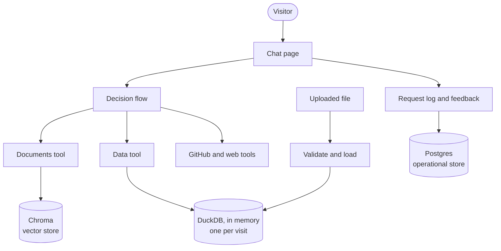
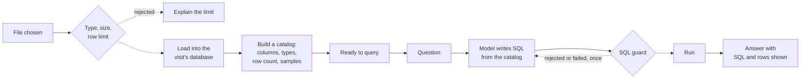

# Version 2 design: bring your own data, and a system of record

| | |
|---|---|
| **Status** | Draft for decision. Nothing in this document is built yet. |
| **Date** | 11 October 2026 |
| **Author** | Jack Mei, with Claude Code |
| **Scope** | Design, decisions, risks, build order and estimate for the second version of the assistant |

For how the current system works, see
[ARCHITECTURE.md](../ARCHITECTURE.md).

## 1. Summary

Version 1 answers from sources the project owns: its knowledge base,
GitHub and one public dataset. Version 2 adds two things.

1. **Bring your own data.** A visitor uploads a small CSV or Excel
   file and asks questions of it. The assistant loads it into an
   analytical database, writes SQL, and shows the query and the rows
   behind each answer.
2. **A system of record.** The assistant keeps a permanent log of
   requests and of visitors' feedback on answers, in a transactional
   database.

Together these give the project the storage pattern most enterprises
use: an analytical store and an operational store, each doing the job
it was built for, alongside the existing vector store.

Before either feature, the code is reorganised so that adding a tool
is one file and not eight edits.

**Estimate:** 17 to 24 hours of working time, in five or six
sessions. Section 12 gives the basis.

## 2. Goals and non-goals

**Goals**

- A visitor can upload a file and get correct, evidenced answers about
  it within the same visit.
- Uploaded data is never stored and never visible to another visitor.
- Every request and every piece of feedback is recorded durably, in a
  form that can be audited.
- Adding a tool requires one new file.
- Every safety property of version 1 still holds, and the new attack
  surface has tests.

**Non-goals**

- User accounts or sign-in.
- Keeping uploaded files between visits.
- Large files. This is a proof of value, not a data platform.
- Joining an uploaded file to the project's own data.
- Using feedback to change the assistant automatically.

## 3. Where version 1 stands

Eight modules in a flat layout, about 2,600 lines of code and 2,200
of tests. 317 tests run on every push. One vector store (Chroma), one
temporary SQLite table for the public dataset, and no permanent
storage of any kind: nothing survives a restart.

Two limits of that design motivate this one:

- **Adding a tool touches eight places:** the fetch function, the
  description the model reads, a graph node, a graph edge, the
  evidence display, the source label, the MCP server and the
  knowledge base.
- **Nothing is remembered.** There is no record of what was asked,
  how often, or whether the answers were any good.

## 4. Proposed architecture

### 4.1 Three stores, three jobs



| Store | Holds | Lifetime | Workload | Why this one |
|---|---|---|---|---|
| **Chroma** | The knowledge base index | Rebuilt on demand | Search by meaning | Unchanged from version 1 |
| **DuckDB, in memory** | A visitor's uploaded file, and the public dataset | One visit | Analytical: scans and aggregates | Built for analytics; runs inside the app; nothing written to disk |
| **Postgres** | The request log and feedback | Permanent, append-only | Transactional: many small writes | Durable, concurrent, auditable |

This is the operational and analytical split at small scale. The
application writes to the operational store. Analysis happens in the
analytical engine. Neither is asked to do the other's job.

### 4.2 Why feedback does not live in DuckDB

It was considered. Three reasons against:

- **Durability.** Uploaded tables are disposable; feedback is
  original data that cannot be rebuilt. The host wipes local files on
  restart.
- **Workload.** DuckDB allows one writing process and is not designed
  for many small concurrent writes.
- **Security.** The model writes the SQL that runs on DuckDB. Keeping
  feedback elsewhere preserves a guarantee that can be stated in one
  line: the model can never write, and can never read another
  visitor's data.

### 4.3 What happens to an uploaded file



The catalog is what the model sees, not the file. It holds the
column names, their types, the row count and a few sample values. It
is also what answers "what columns are in my file?" without any SQL.

### 4.4 Layers

Dependencies point downward only.

| Layer | Contents |
|---|---|
| **Interfaces** | Chat page, MCP server |
| **Orchestration** | The LangGraph flow |
| **Capabilities** | Tools, retrieval, screening |
| **Storage and ingestion** | Vector store, analytical store, operational store; loaders for documents and files |
| **Providers** | Language models, outside APIs |

## 5. Decisions made

| Decision | Choice | Why | Alternative set aside |
|---|---|---|---|
| Analytical store | DuckDB, in memory | Built for analytics, no server, open source | SQLite: works, but not an analytical engine |
| Operational store | Managed Postgres | Durable on a host that wipes local files; the standard choice | A local file: lost on restart |
| Where feedback lives | Postgres, not DuckDB | Section 4.2 | One database for everything |
| Lifetime of uploads | The visit only | Privacy, and no storage to manage | Keeping files: needs accounts and a retention policy |
| One SQL engine | Move the public dataset to DuckDB too | One dialect and one set of safety rules to maintain | Keeping SQLite beside DuckDB |
| Storage access | Behind a small interface with swappable backends | Tests need no real database; the provider can change later | Calling Postgres directly throughout |
| Order of work | Restructure first, then features | A no-behaviour change is safest alone | Restructuring while adding features |
| Tool design | One file per tool, read by the graph, the page and the MCP server | Removes the eight-places problem | Folders only, same wiring |

## 6. Decisions still open

Each needs an answer before its phase starts.

| # | Question | Recommendation | Needed by |
|---|---|---|---|
| 1 | Which file types? | CSV and Excel (`.xlsx`), first sheet only to begin with | Phase 3 |
| 2 | Size limits? | 5 MB and 50,000 rows, then measure on the host | Phase 3 |
| 3 | One file per visit, or several? | One. Several invites joins, which are out of scope | Phase 3 |
| 4 | How is Excel read? | A Python library, directly. Then offer the query as a tool on the project's own MCP server | Phase 3 |
| 5 | Which Postgres provider? | Any free managed tier; check current limits before choosing | Phase 4 |
| 6 | Does the request log keep the question text? | Metadata only at first: tool, model, timing, tokens, outcome | Phase 4 |
| 7 | What form does feedback take? | Thumbs up or down, with an optional comment | Phase 5 |
| 8 | Is feedback in the first release of version 2? | No. Ship upload first, then the record | Planning |

## 7. Security and privacy

Version 1's guardrails assumed the project controlled its data.
Uploads end that assumption.

| Risk | Control |
|---|---|
| A hostile or oversized file | Check type by content, not name. Cap size and rows. Never run macros or formulas. Refuse with a clear message. |
| Prompt injection through the data | Column names and cell values reach the model. They travel as data in the user role, are length-limited, and get their own injection tests. |
| The model's SQL reaching outside the database | DuckDB can read files and call the network from SQL. Both are switched off. One read-only `SELECT`, a row limit and a time limit, as now. |
| One visitor reading another's upload | A separate in-memory database per visit. |
| The model reading the system of record | The model's SQL runs only on DuckDB. It has no connection to Postgres. |
| Uploaded content leaving the system | Column names and sample values are sent to the model provider. The page says so before upload: do not upload confidential data. |
| The log becoming a store of personal data | It records what happened, not what was uploaded. Question text is off by default (open decision 6). |
| Feedback treated as truth | Feedback is reviewed by a person before it becomes a test case. |

Two things are new obligations and not just controls: a visible
notice of what is sent where, and a stated retention period for the
log.

## 8. Data model

**Postgres**

`request_log`, one row per message, never updated:

| Column | Purpose |
|---|---|
| `id`, `created_at` | Identity and time |
| `session_id` | A random ID for the visit; not a person |
| `tool`, `status` | What answered, and the outcome |
| `model`, `fallback_used` | Which model, and whether the fallback ran |
| `duration_ms`, `tokens` | Cost of the request |
| `app_version` | The commit that was running |
| `error_type` | Set when the request failed |

`feedback`, one row per rating, never updated:

| Column | Purpose |
|---|---|
| `id`, `created_at` | Identity and time |
| `request_id` | The request being rated |
| `rating` | Up or down |
| `comment` | Optional |
| `reviewed`, `promoted` | Whether a person has reviewed it, and whether it became a test case |

**DuckDB, per visit**

One table for the uploaded file, named by the system and not by the
visitor, plus the catalog built from it.

## 9. Code structure

```
Claude_Demo/
├── app.py                 entry point, a few lines
├── mcp_server.py          entry point, a few lines
├── rag_demo/
│   ├── config.py          every setting in one place
│   ├── llm/               model calls, fallback, screening
│   ├── ingestion/         documents to chunks; files to tables
│   ├── storage/           vectors, tables, records
│   ├── tools/             one file per tool
│   ├── graph/             the LangGraph flow
│   └── interfaces/        chat page, MCP server
├── data/                  the knowledge base
├── evals/
├── tests/                 mirrors the package
└── docs/
```

Entry points stay at the top so the host and Claude Code start the
app exactly as they do now.

**A tool, as one file.** Each tool declares what the rest of the
system needs to know about it:

```python
class Tool:
    name: str          # what the model calls it
    when_to_use: str   # the line the model reads to choose it
    source_label: str  # shown under each answer

    def run(self, question, context): ...       # fetch and answer
    def show_evidence(self, result): ...        # draw it on the page
```

The graph builds its choices from the list of tools, the page asks
the tool how to show its evidence, and the MCP server exposes the
same list. This sketch will change when it meets a real fourth tool;
it is here to show the direction.

## 10. Risks

| Risk | Likelihood | Impact | Response |
|---|---|---|---|
| The restructure breaks something the tests do not cover | Low | Medium | Move files with no other change; run the full suite and a live check before and after |
| The host's memory cannot hold the embedding model and DuckDB together | Medium | High | Measure early in phase 3 with the largest allowed file; lower the cap if needed |
| The model writes poor SQL for unfamiliar data | High | Medium | A catalog with types and samples; one corrected retry; show the SQL so a wrong answer is visible |
| A free database tier pauses, limits connections or is withdrawn | Medium | Medium | The storage interface; a failed write must never block an answer |
| Injection through uploaded data | Medium | Medium | Section 7; tests written before the feature is switched on |
| Token cost per data question rises | High | Low | Cap the catalog's size; measure; the daily allowance is already tight |
| Scope grows | High | High | Section 13. Each phase ships on its own; later phases can be dropped |

## 11. Build order

Each phase ends with all tests passing, a live check, a commit and a
working deployed app.

| Phase | Delivers | Done when | Estimate |
|---|---|---|---|
| **1. Restructure** | The package layout; nothing else changes | Same tests pass; the live app behaves identically | 2 to 3 h |
| **2. Tool interface** | One file per tool; the existing tools moved onto it | Adding a trial tool needs one file | 2 to 3 h |
| **3. Upload and query** | File validation, per-visit DuckDB, catalog, rebuilt SQL guard, upload control, notices, injection tests; the public dataset moved to DuckDB | A visitor uploads a file and gets correct answers with SQL shown; hostile files and injected data are refused | 6 to 8 h |
| **4. System of record** | Storage interface, Postgres backend, request log | Every request is logged; a database outage does not affect answers | 3 to 4 h |
| **5. Feedback** | Rating control, feedback table, a way to review ratings | A rating is stored against its request and can be reviewed | 2 to 3 h |
| **6. Evaluation and documents** | Evaluation cases for uploaded data; architecture and knowledge base updated | The assistant can explain version 2; the report covers the new tool | 2 to 3 h |
| | | **Total** | **17 to 24 h** |

Phases 1 to 3 are a complete release on their own. Phases 4 and 5
are a second.

## 12. The estimate and its basis

The estimate is built from what version 1 actually took, not from
how long the code takes to write.

**What was observed**

| Session | Working time (approx.) | Commits | What it produced |
|---|---|---|---|
| 4 October | 9 h | 16 | Empty folder to a deployed assistant with four sources |
| 5 October | 3 h | 3 | History clean-up, license, prompt injection defences |
| 6 October | 6 h | 5 | CI, the specification, the model evaluation |
| 11 October | 3 h | 2 so far | History rewrite, evaluation record, this design |

About 21 hours in total, for 2,600 lines of code, 317 tests and 18
recorded problems. Times are approximate, from commit timestamps and
session notes.

**The pattern in those numbers**

- **Writing a feature was the short part.** On the first day most
  features were committed 15 to 50 minutes after the one before.
- **Making it correct took about twice as long as making it work.**
  The first working prototype took about 3 hours; the remaining 6
  hours of that day went on problems found by live checks: retrieval
  misses, a stale index, wrong SQL results, an invented answer.
- **Discussion is real time.** Each decision in this project was
  talked through before it was built, and several were reversed by
  evidence. That time is in the totals above and in the estimate.

**How the estimate was made**

For each phase: the time to build and test it at the observed pace,
doubled for live checks, fixes and discussion. The range reflects
how much is unknown. Phase 3 is the widest because it has the most
that has never been tried here: a new database, a new safety guard,
untrusted input and a memory limit that has not been measured.

**What it assumes**

- Sessions of 3 to 6 hours, as so far.
- At the current rhythm of a session every few days, about two to
  three weeks of calendar time.
- Free service tiers remain usable. Live checks share a daily token
  allowance with the deployed app, which limits how much can be
  verified in one day.

**What would change it**

| If | Then |
|---|---|
| The host cannot hold DuckDB and the embedding model | Phase 3 grows by 2 to 4 h, or the upload cap drops sharply |
| Several files per visit are wanted | Phase 3 roughly doubles |
| The log must hold question text | Add a retention and redaction design: 2 to 3 h |
| Feedback must feed the evaluation automatically | A new phase; not estimated |

## 13. Out of scope for version 2

Stated so they are decisions and not omissions:

- Accounts, sign-in and per-user history.
- Files kept between visits.
- More interfaces, such as an API or a chat-platform integration.
- More model providers.
- A model acting as judge of answer quality.
- Replacing the vector store.

The layering in section 4.4 is meant to keep each of these possible
later without reworking what is built now.

## 14. Version 2 is done when

- [ ] A visitor can upload a CSV or Excel file within the limits and
      get correct answers, each showing its SQL and rows.
- [ ] A file over the limits, or of the wrong type, is refused with a
      clear reason.
- [ ] Injection attempts placed in column names and cell values are
      contained, with tests.
- [ ] Two visitors cannot see each other's data, with a test.
- [ ] Every request is recorded in the operational store, and an
      outage of that store does not stop answers.
- [ ] A visitor can rate an answer, and the rating can be reviewed.
- [ ] Adding a tool requires one new file.
- [ ] The page states what is sent to outside services and what is
      recorded.
- [ ] All tests pass on every push, and the evaluation report covers
      the new tool.
- [ ] The architecture document and the knowledge base describe
      version 2.
